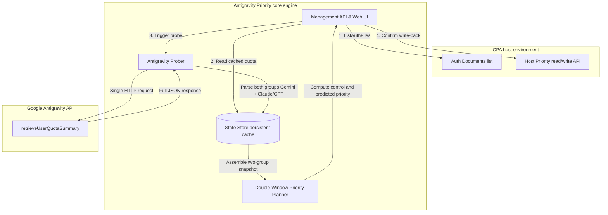

# Antigravity Priority v1.1.0 Roadmap & Technical Spec

**Target version**: v1.1.0  
**Status**: All Requirements Completed / Ready for Release  
**Created**: 2026-08-18  
**Previous version**: v1.0.1 (released)

---

## Contents
1. [Requirements Summary](#1-requirements-summary)
2. [Detailed Specifications](#2-detailed-specifications)
   - [2.1 REQ-01: Adaptive next-run countdown format with live updates](#21-req-01-adaptive-next-run-countdown-format-with-live-updates)
   - [2.2 REQ-02: Tolerant config parsing, graceful default fallback, and diagnostic warnings](#22-req-02-tolerant-config-parsing-graceful-default-fallback-and-diagnostic-warnings)
   - [2.3 REQ-03: Native-style custom Confirm dialog](#23-req-03-native-style-custom-confirm-dialog)
   - [2.4 REQ-04: Always-visible credential list, on-demand quota probing, and two-phase Dry-Run](#24-req-04-always-visible-credential-list-on-demand-quota-probing-and-two-phase-dry-run)
   - [2.5 REQ-05: Both model groups parsed from one request, with instant predicted-priority switching](#25-req-05-both-model-groups-parsed-from-one-request-with-instant-predicted-priority-switching)
   - [2.6 REQ-06: UI layout, independent scroll containers, compact two-column cards, and smooth motion](#26-req-06-ui-layout-independent-scroll-containers-compact-two-column-cards-and-smooth-motion)
   - [2.7 REQ-07: Run-history change detail modal (Apply changes & Dry-Run prediction comparison)](#27-req-07-run-history-change-detail-modal-apply-changes--dry-run-prediction-comparison)
   - [2.8 REQ-08: Auto-schedule time window, one-click pause/resume, and persistent panel-level control](#28-req-08-auto-schedule-time-window-one-click-pauseresume-and-persistent-panel-level-control)
   - [2.9 REQ-09: UI config center with hot reload at runtime, no restart](#29-req-09-ui-config-center-with-hot-reload-at-runtime-no-restart)
   - [2.10 REQ-10: Priority bucketing of close scores and native load balancing](#210-req-10-priority-bucketing-of-close-scores-and-native-load-balancing)
   - [2.11 REQ-11: Real-time 429 rate-limit interception and cooldown circuit breaker](#211-req-11-real-time-429-rate-limit-interception-and-cooldown-circuit-breaker)
   - [2.12 REQ-12: Sliding-window multi-sample adaptive burn learning with configurable sample capacity](#212-req-12-sliding-window-multi-sample-adaptive-burn-learning-with-configurable-sample-capacity)
3. [Architecture & Domain Model](#3-architecture--domain-model)
4. [Frontend UX & State Machine](#4-frontend-ux--state-machine)
5. [Backend API & Data Schema](#5-backend-api--data-schema)
6. [Testing Strategy](#6-testing-strategy)
7. [Bug Fixes](#7-bug-fixes)

---

## 1. Requirements Summary

> **Note**: As of this version, all 12 core requirements and 3 critical bug fixes planned for v1.1.0 are fully implemented and have passed full test acceptance.

| ID | Requirement | Module | Priority | Status | Value |
| :--- | :--- | :--- | :--- | :--- | :--- |
| **REQ-01** | Live next auto-run countdown with adaptive time format | Frontend / Backend | P1 | ✅ Done | Replaces a static string with a per-second adaptive countdown |
| **REQ-02** | Case-tolerant plugin config parsing with robust fallback for every field | Config parsing | P0 | ✅ Done | A mistyped value (e.g. `30M`) no longer crashes the plugin on startup or stops it |
| **REQ-03** | Custom modal Confirm dialog replaces the browser's native confirm | Frontend UI | P1 | ✅ Done | Matches the CPA Host light/dark themes and design system |
| **REQ-04** | Always-visible credential list, cached quota with on-demand probing, two-phase Dry-Run | Scheduling & interaction | P0 | ✅ Done | Avoids the risk controls and 429s caused by hitting the Google quota endpoint too often |
| **REQ-05** | Extract all group quotas from one HTTP request and switch predicted priority across model groups instantly | Core engine | P0 | ✅ Done | One request returns both Gemini and Claude/GPT quotas; the predicted view switches instantly |
| **REQ-06** | UI layout, independent scroll containers, compact two-column cards, smooth motion | Frontend UI / motion | P1 | ✅ Done | No whole-page scrolling; list/two-column view toggle; copy button and refined motion |
| **REQ-07** | Run-history change detail modal (Apply changes & Dry-Run prediction comparison) | Diagnostics & history | P1 | ✅ Done | Past runs can be inspected, comparing what Apply wrote back and the before/after quotas of a Dry-Run |
| **REQ-08** | Auto-schedule time window, one-click pause/resume, persistent panel-level control | Scheduling core / UI | P0 | ✅ Done | Start/stop scheduling and set active hours (e.g. night / working hours) from the UI, without editing YAML or restarting |
| **REQ-09** | UI config center with hot reload at runtime, no restart | Config / UI / core | P0 | ✅ Done | Moves every scheduling setting that does not need a restart into a dedicated UI config center, minimizing CPA YAML, with changes live within seconds |
| **REQ-10** | Priority bucketing of close scores and native load balancing | Priority planning / core | P0 | ✅ Done | Accounts within an urgency tolerance share a priority, so CPA's native round-robin spreads load and no single account gets hammered into 429 |
| **REQ-11** | Real-time 429 rate-limit interception and cooldown circuit breaker | Core / interceptor / state | P0 | ✅ Done | Catches 429s from live calls, drops the account to the `-1` fallback tier immediately, and restores it automatically on expiry |
| **REQ-12** | Sliding-window multi-sample adaptive burn learning with configurable sample capacity | State estimation / config / UI | P0 | ✅ Done | A multi-sample time-ordered queue accumulates deltas so slow, small consumption is no longer lost; capacity is configurable in the UI (2-30) |

---

## 2. Detailed Specifications

### 2.1 REQ-01: Adaptive next-run countdown format with live updates

#### Current state and problem
The backend `Diagnostics` endpoint returns `next_wait` as Go `time.Duration.String()` (e.g. `18m37.989992568s`). The frontend renders this static string as-is: it looks poor and does not count down.

#### Technical design
1. **API extension**:
   - The backend adds `next_run_at` to `Diagnostics.scheduler` (an absolute RFC3339 timestamp, e.g. `2026-08-18T10:18:37Z`).
2. **Adaptive format algorithm (`formatSchedulerCountdown`)**:
   - Remaining $> 24\text{h}$: show `Xd XXh XXm` (e.g. `2d 04h 15m`).
   - $1\text{h} \le \text{remaining} \le 24\text{h}$: show `XXh XXm XXs` (e.g. `02h 15m 30s`).
   - $1\text{m} \le \text{remaining} < 1\text{h}$: **omit `h`**, show `XXm XXs` (e.g. `18m 38s`).
   - $\text{remaining} < 1\text{m}$: **omit `m`**, show `XXs` (e.g. `45s`).
   - When the countdown expires, show `00s` or `Ready`.
3. **Frontend driver**:
   - The frontend main loop `setInterval(updateAllCountdowns, 1000)` drives the scheduler countdown, refreshing it in step with the quota window countdowns.

---

### 2.2 REQ-02: Tolerant config parsing, graceful default fallback, and diagnostic warnings

#### Current state and problem
`internal/config/parse.go` and `config.go` validate strictly. If `config.yaml` contains a format `time.ParseDuration` cannot parse (e.g. upper-case units such as `30M`, `1H`) or an invalid field value, `LoadBytes` returns `ErrInvalidConfig` and the plugin stops.

#### Technical design
1. **Case normalization for duration units**:
   - Lower-case `interval` before parsing (`30M` $\to$ `30m`, `1H` $\to$ `1h`, `15S` $\to$ `15s`, `500MS` $\to$ `500ms`).
2. **Graceful fallback for every field**:
   - **`interval`**: if parsing fails or the value is $\le 0$, fall back to the default `15m` and emit a Warning.
   - **`antigravity_model_group`**: if empty or invalid (not `gemini` / `claude_gpt`), do not abort; fall back to `gemini` and emit a Warning.
   - **`max_concurrency`**: if not a number or $< 1$, fall back to `6` and emit a Warning.
   - **`min_change`**: if not a number or $< 0$, fall back to `1` and emit a Warning.
   - **`priority_rules.boost_start_priority`**: if $< 1$ or invalid, fall back to `999` and emit a Warning.
   - **`priority_rules.normal_start_priority`**: if $< 1$ or invalid, fall back to `100` and emit a Warning.
3. **How warnings appear on the System Diagnostics page (exact UI placement)**:
   - **API output**: the backend returns `config_warnings: []string` on the root object of `/diagnostics` (e.g. `["Config interval='30M' is non-standard; normalized to '30m' and applied", "Config antigravity_model_group='xxx' is invalid; fell back to default 'gemini'"]`).
   - **UI placement**: on the **"System Diagnostics"** page of the management panel, **directly below the "System diagnostics and scheduler status" heading (`<h2>`)** and **directly above the `Scheduler:` info card (`#schedulerInfo`)**.
   - **Visual form**:
     - When warnings exist, render one yellow/amber alert bar per warning (with a `⚠️` icon, warning-style border, and soft background).
     - When there are no warnings, hide the area entirely.
   ```
   [Panel tab: System Diagnostics]
   --------------------------------------------------------------------------------------
   <h2>System diagnostics and scheduler status</h2>
   
   <!-- Warning area: below the heading, above the Scheduler info -->
   [⚠️ Config interval='30M' is non-standard; normalized to '30m' and applied]
   [⚠️ Config antigravity_model_group='custom' is invalid; fell back to default 'gemini']
   
   [Scheduler: Interval: 30m · Active: Yes · Next Wait: 18m38s · Next Run: 10:30:00]
   
   [Raw JSON diagnostics view...]
   --------------------------------------------------------------------------------------
   ```

---

### 2.3 REQ-03: Native-style custom Confirm dialog

#### Current state and problem
The reset-default-priority button (`triggerReset`) calls the browser's native `confirm()`. Its style clashes with the minimal modern CPA Host look and feels jarring inside the embedded iframe.

#### Technical design
1. **DOM structure**:
   - Reuse the existing `modal-backdrop` and `modal` system and add a dedicated `#confirmModal`.
2. **Visual design**:
   - The title carries a danger icon (e.g. `⚠️ Confirm credential priority reset`).
   - The body explains the impact: "This clears the custom priority field on every Antigravity credential and returns them to the host's default unassigned state."
   - Buttons: `Cancel` (secondary) and `Confirm reset` (red danger button `.btn-danger`).
3. **Reusable JavaScript function**:
   ```javascript
   function showThemedConfirm({ title, message, confirmText, cancelText, isDanger }) => Promise<boolean>
   ```

---

### 2.4 REQ-04: Always-visible credential list, on-demand quota probing, and two-phase Dry-Run

#### Current state and problem
- Page load/refresh reads only the cache with no network request, but clicking "Dry-Run" forces an immediate probe of every credential.
- Repeated accidental Dry-Run clicks can send requests densely enough to trip Google API risk controls or 429 limits.
- Credentials that have never been run do not appear on the page immediately.

#### Technical design
1. **Always-visible credential list**:
   - On page load or "Refresh", read metadata for all current Antigravity credentials (name, AuthIndex, current Host priority) directly from the CPA host API.
   - Join with the local persisted `state.Store` cache:
     - With cached quota: show the 5h/7d progress bars and "last fetched" time (e.g. "5m ago").
     - Without cached quota: the card keeps its basic info and is marked "Not Probed".
2. **Separate "Fetch latest quota" with debounce cooldown**:
   - Decouple "network probing" from "Dry-Run change calculation".
   - The control bar has a separate **`📡 Fetch latest quota`** button that probes and updates the local cache and KPIs.
   - After a click the button enters a 10-second frontend cooldown countdown to prevent click spamming.
3. **Two-phase Dry-Run**:
   - When the user clicks `🔍 Dry-Run`:
     - By default it plans priorities purely in memory from the latest quota data on hand and immediately opens the change-preview Diff modal, with **zero network requests and zero risk-control exposure**.
     - If the last probe is stale (e.g. over 1 hour, or some credentials were never probed), the top of the Diff modal shows a hint: "Fetch the latest quota before writing back."

---

### 2.5 REQ-05: Both model groups parsed from one request, with instant predicted-priority switching

#### Current state and problem
The Google Antigravity quota endpoint returns the full quota for every model on the account (Gemini + Claude/GPT) in a single response, but v1.0.1 only parsed the one configured group and discarded the other. Switching the dropdown on the frontend gave no visible feedback.

#### Technical design
1. **Full decode from a single probe**:
   - On receiving the Google quota response, the backend parses both the `gemini` and `claude_gpt` Candidate Windows in one pass and stores them in `state.Store` under `authIndex:gemini` and `authIndex:claude_gpt`.
2. **Client-Side Instant Switch**:
   - Switching the model-group dropdown re-renders from the local two-group snapshot, with **zero latency and zero network requests**.
3. **"Effective" vs "Predicted Priority" semantics**:
   - Each credential in the CPA host has exactly one `priority` integer.
   - If `config.yaml` sets the control group to `gemini`:
     - Dropdown on `Gemini`: shows the effective priority currently written back and the target priority.
     - Dropdown on `Claude & GPT`: quota bars, urgency, and burn rate show Claude/GPT data, and the computed priority is labeled **`🔮 Predicted Priority`**.
     - An info bar explains: "The control group is Gemini. This view shows Claude/GPT quota and simulated priority. To write back to the host using this group, set antigravity_model_group: claude_gpt in the config file."
   - Clicking "Apply now" from a non-control group view is intercepted by the frontend, which prompts the user to switch back to the control group or explains the config rule.

---

### 2.6 REQ-06: UI layout, independent scroll containers, compact two-column cards, and smooth motion

#### Current state and problem
- All page content shares the global body scroll; a long credential list or run history scrolls the header and KPIs out of view.
- Credential cards only come as single-row large cards, which wastes space when there are many credentials.
- The Raw JSON on the diagnostics page stretches the whole page and has no one-click copy.
- State changes and interactions have no micro-motion, so transitions feel abrupt.

#### Technical design
1. **Account area: list / compact two-column toggle with independent scrolling**:
   - **View toggle**: the control bar gets a view switch (`📄 List view` / `🔲 Two-column cards`) that switches to a compact two-column grid (`grid-template-columns: repeat(2, minmax(0, 1fr))`).
   - **Compact card layout**: in two-column mode, tighten vertical and horizontal spacing and align the content compactly (account/ID/status on the left, priority and metrics on the right, compact 5h/7d bars at the bottom).
   - **Scroll Containment**: in both modes the **whole page must never scroll**. The credential container `#credentialsContainer` gets its own `max-height: calc(100vh - 280px); overflow-y: auto;` with a thin minimal scrollbar, so the top nav, KPI area, and control bar stay visible.
2. **Run-history area: independent scrolling**:
   - `#historyList` also gets `overflow-y: auto; max-height: calc(100vh - 280px)`; it scrolls internally while the outer page stays still.
3. **System diagnostics JSON area: independent scrolling and a Copy button**:
   - **Independent container scroll**: `<pre id="rawDiagnostics">` gets `max-height: 480px; overflow: auto;` so content scrolls horizontally/vertically inside the code block without stretching the parent page.
   - **Copy button**: add a `📋 Copy JSON` button at the top right of the JSON container. Clicking writes to the clipboard via `navigator.clipboard.writeText`, briefly shows `✅ Copied`, and fires a light success Toast.
4. **Global micro-interactions and animation**:
   - **Toast notifications**:
     - Enter: slide in and fade in at the top right (`transform: translateX(30px) scale(0.95); opacity: 0` $\to$ `transform: translateX(0) scale(1); opacity: 1`, `240ms cubic-bezier(0.16, 1, 0.3, 1)`).
     - Leave: fade out and shift up slightly (`opacity: 0; transform: translateY(-8px)`, `200ms ease`).
   - **Modal micro-interactions**:
     - Backdrop: `opacity: 0` $\to$ `opacity: 1` (`200ms ease`).
     - Dialog: `transform: translateY(12px) scale(0.96); opacity: 0` $\to$ `transform: translateY(0) scale(1); opacity: 1` (`260ms cubic-bezier(0.16, 1, 0.3, 1)`).
   - **Loading & Shimmer**:
     - While data refreshes, cards show a light pulsing ripple (`pulse shimmer`).
     - Buttons in loading state show a small inline rotating spinner.
   - **Custom Select Dropdown**:
     - Open/close animates height and opacity (`transform: scaleY(0.92); opacity: 0` $\to$ `transform: scaleY(1); opacity: 1`, `150ms cubic-bezier(0.16, 1, 0.3, 1)`).
   - **Tab switches and gauge bars**:
     - Tab panels fade in slightly on switch (`opacity 0.18s ease-out`).
     - Progress bar width changes transition smoothly (`transition: width 0.4s cubic-bezier(0.4, 0, 0.2, 1)`).

---

### 2.7 REQ-07: Run-history change detail modal (Apply changes & Dry-Run prediction comparison)

#### Current state and problem
The run-history list only shows run time, success/failure/skip counts, and a summary line. Users cannot trace which accounts' priorities a run actually changed, nor see the before/after quota comparison of a Dry-Run.

#### Technical design
1. **Entry point on history cards**:
   - Add a **`🔍 View Details`** button at the top right of each run-history item.
2. **Detail modal for `APPLY` entries**:
   - Show every account priority change actually written back in that run:
     - Account name and AuthIndex
     - Old Host priority $\to$ new effective priority (e.g. `100` $\to$ `998`)
     - Whether it received a `🚀 Boost`
     - Reason for the decision (e.g. `boosted: high 5h/7d quota` or `depleted: weekly window exhausted`)
     - Disabled state change (if any)
3. **Detail modal for `DRY_RUN` entries (full before/after comparison)**:
   - Show how each account's state changed in that dry run:
     - **Quota**: previous 5h/7d quota percentage $\to$ newly fetched 5h/7d quota percentage
     - **Priority**: previous effective priority $\to$ newly computed **Predicted Priority**
     - **Key derived metrics**: computed Urgency and Cycle Burn Rate
     - **Scheduling reason**: the prediction reason and whether the dynamic Boost threshold is met
4. **Persistence**:
   - The backend `RunHistoryEntry` gains a `Snapshot *apply.PlanSnapshot` field, so history persisted to `data/antigravity-priority-cache.json` keeps the full details of every run and can still be reviewed after a restart.

---

### 2.8 REQ-08: Auto-schedule time window, one-click pause/resume, and persistent panel-level control

#### Current state and problem
- `auto_apply` can only be set statically in `config.yaml`; changing it requires logging into the server, editing the file, and reloading.
- No time-window control: auto-scheduling runs at a fixed rate whether it is the dead of night or peak hours, with no way to set active hours (e.g. only `09:00 - 23:00`, sleeping at night to save probe quota).
- No panel-level pause: during an incident or manual investigation there is no way to suspend auto-scheduling from the UI.

#### Design choice: why manage this from the UI panel?
1. **Zero-friction interaction**: users can pause/resume or adjust the time window from the web console at any time, **without editing the host YAML and without restarting or reloading CPA**.
2. **State persists naturally**: all dynamic runtime state (`auto_apply_paused`, `schedule_window`) is persisted atomically to the plugin's own `data/antigravity-priority-cache.json` and survives a host restart.
3. **Layered config (UI runtime override first, static YAML as initial fallback)**:
   - YAML can set initial fallback values (`auto_apply: true`, `schedule_window: "08:30-23:30"`).
   - The UI panel has the highest runtime authority and offers a "Restore YAML defaults" button.

#### Technical design
1. **Panel-level Pause / Resume toggle**:
   - The control bar gets a scheduler state toggle: `🟢 Auto-schedule running` $\rightleftharpoons$ `⏸ Auto-schedule paused`.
   - Clicking switches state immediately; the backend singleton Worker sleeps or wakes at once without restarting the goroutine.
2. **Active Schedule Time Window configurator**:
   - A time-range dialog or control strip sets the daily active hours (e.g. `09:00 to 23:00`).
   - **Cross-midnight support**: the algorithm handles overnight windows (e.g. `22:00 to 06:00`).
   - **All-day option**: one click switches to `00:00 - 24:00 (all day)`.
3. **Adaptive countdown during sleep and KPI state linkage**:
   - **Outside the active window**:
     - The scheduler skips background probing and write-back (zero network cost).
     - The top KPI card shows: `🌙 Scheduler sleeping (outside active window: 09:00-23:00)`.
     - The next-run countdown switches to: "Active window opens in 08h 24m 15s".
   - **When manually paused**:
     - The top KPI card shows: `⏸ Scheduler manually paused`.
     - The countdown shows: `Paused`.
4. **Management API extension**:
   - Add `POST /schedule/config`, which accepts `{ "paused": boolean, "window_start": "09:00", "window_end": "23:00" }`.

---

### 2.9 REQ-09: UI config center with hot reload at runtime, no restart

#### Current state and problem
- The CPA plugin config lives in the host `config.yaml`. Changing business parameters such as `interval`, `antigravity_model_group`, or `boost_start_priority` means editing YAML by hand, which can trigger a CPA host reload or even a process restart.
- Hand-written YAML is prone to case, indentation, and type errors.
- Apart from the `enabled` switch, which the host needs to decide whether to load the plugin, every business and scheduling setting can be changed at runtime and take effect immediately.

#### Architecture and config decomposition principles
1. **Minimal host YAML**:
   - The CPA host `config.yaml` keeps only `enabled: true` (plus the default `state_cache_path` storage path).
   - This prevents hand-entered business parameters from breaking host startup.
2. **UI Config Center tab**:
   - The top navigation gets a dedicated **`⚙️ Config Center`** tab.
   - All runtime business parameters are configured here visually, with immediate validation, one-click save, and one-click reset to defaults.
3. **Hot reload and persistence**:
   - Config is saved to the `app_config` node of the atomically persisted local file `data/antigravity-priority-cache.json`.
   - On save the backend validates value ranges (e.g. concurrency $\ge 1$, scores $1 \sim 999$).
   - After a successful save the in-memory `Runtime` config is swapped atomically, and the scheduler Worker picks up changes to `interval` or `auto_apply` and resets its timer at once: **hot reload in zero seconds, no plugin restart or host reload**.

#### Frontend form structure and groups
1. **Auto-scheduling and active hours**:
   - `auto_apply` master auto-schedule switch (on/off)
   - `interval` scheduling period (5m / 15m / 30m / 1h / custom)
   - `antigravity_model_group` quota control model group (Gemini / Claude & GPT)
   - `schedule_window` daily active hours (on/off, 09:00-23:00, supports overnight and all-day modes)
2. **Probe and write-back performance**:
   - `max_concurrency` max concurrent probe requests (default 6, range 1-32)
   - `min_change` minimum priority change to write (default 1, range 0-100)
3. **Priority Rules**:
   - `priority_rules.enabled` enable the smart dual-window priority rules (on/off)
   - `priority_rules.boost_start_priority` base starting priority for dynamic boost (default 999)
   - `priority_rules.normal_start_priority` base starting priority for normal healthy accounts (default 100)
4. **Bottom action bar**:
   - `💾 Save & Apply`
   - `🔄 Reset to Defaults`

#### Management API extension
- `GET /v0/management/plugins/antigravity-priority/runtime-config`: get the full current runtime config.
- `POST /v0/management/plugins/antigravity-priority/runtime-config`: submit and hot-apply a new config.

---

### 2.10 REQ-10: Priority bucketing of close scores and native load balancing

#### Current state and problem
After sorting, the algorithm assigns candidate accounts strictly unique, decreasing priorities (e.g. 9 accounts get `100, 99, 98, 97, 96, 95...`). CPA routing then sends 100% of traffic to the single highest-priority account (`100`), so under high concurrency that account is overwhelmed and returns Google 429 rate limits while the other 8 healthy accounts with similar quota sit idle.

#### Technical design
1. **Urgency tolerance bucketing (`UrgencyTolerance`)**:
   - Introduce a configurable tolerance $\Delta \text{Urgency}$ (default `0.05`, configurable in the UI from `0.00 ~ 0.50`).
   - When sorting Tier 1 (Boosted) and Tier 2 (Regular Active):
     - If an account's urgency differs from the current bucket's base account by $\le \text{UrgencyTolerance}$, it **gets the same priority integer** (e.g. both `100`).
     - Only when the difference is $> \text{UrgencyTolerance}$ does the next bucket step down (e.g. `99`).
2. **CPA native load balancing**:
   - The CPA host round-robins credentials of equal priority, spreading high-concurrency load evenly across all healthy accounts in the same bucket and eliminating single-account 429 saturation.

---

### 2.11 REQ-11: Real-time 429 rate-limit interception and cooldown circuit breaker

#### Current state and problem
When an account occasionally hits a Google transient 429 rate limit and there is no cooldown breaker, CPA keeps rotating back to that account on retries, causing cascading retry storms and higher latency.

#### Technical design
1. **Detect 429 events from multiple sources**:
   - Intercept 429 / `RESOURCE_EXHAUSTED` events from CPA `filter.response`, `filter.complete`, and `filter.error`.
   - Detect 429 status codes from probes.
2. **Non-destructive soft-demotion isolation (`priority = -1`)**:
   - On a 429, immediately lower the account's priority in the CPA host to **`-1`** (keeping `disabled = false`).
   - Under CPA routing order `999 > 100 > 0 (unset default) > -1 (cooldown floor)`, the account instantly moves behind every healthy account, stopping high-frequency retries.
   - Record `CooldownUntil = now + cooldownMinutes` (default `5` minutes, configurable in the UI from `1 ~ 60` minutes) and persist it to `state.Store`.
3. **Fully automatic recovery**:
   - When the cooldown expires, the next scheduled run restores the account's normal healthy priority with no manual action.
   - The web UI dashboard shows a live **`⏳ 429 cooling down`** badge with a countdown.

---

### 2.12 REQ-12: Sliding-window multi-sample adaptive burn learning with configurable sample capacity

#### Current state and problem
The adaptive learning rate used to compare adjacent probe snapshots pairwise (keeping only the latest record and subtracting). With light usage, when 5h short-window consumption within one probe interval (e.g. 15 minutes) is under $5\%$ ($\Delta R_{\text{5h}} < 0.05$), two adjacent points never reach the learning threshold, and each probe overwrites the previous record. Slow, small consumption is lost and the learning rate stays at the default `0.15` indefinitely.

#### Technical design
1. **Sliding Window FIFO Queue of samples**:
   - Add `Samples []QuotaSample` to the persisted `Entry` (recording `ObservedAt`, `ShortWindowResetAt`, `ShortWindowRem`, `LongWindowRem`).
   - Capacity is set by the dynamic config `quota_sample_capacity` (default `6`, configurable in the range `2 ~ 30`).
2. **Three defensive lifecycle rules**:
   - **Reset Eviction**: when the 5h short-window reset time changes or quota increases, clear the `Samples` queue and make the current point the baseline of the new cycle.
   - **Zero Consumption Deduplication**: when quota has not changed, only refresh the timestamp of the latest sample instead of appending a duplicate, so useful samples are not pushed out by noise.
   - **FIFO Sliding**: when over capacity, pop the oldest sample FIFO to keep queue length stable.
3. **Cumulative learning across the span**:
   - Compute span consumption from the first sample $S_0$ and the current sample $S_{\text{curr}}$: $\Delta R_{\text{5h}} = (S_0.R_{\text{5h}} - S_{\text{curr}}.R_{\text{5h}})/100$.
   - When cumulative $\Delta R_{\text{5h}} \ge 0.05$ and $\Delta R_{\text{7d}} > 0$, compute the instantaneous ratio $obs = \Delta R_{\text{7d}} / \Delta R_{\text{5h}}$, clamp it to $[0.08, 0.30]$, update $C_{\text{cycle}}$ by EMA with $\alpha=0.3$, and make the current point the new baseline, so consumption is learned accurately and never double-counted.
4. **Full isolation between model groups**:
   - The Gemini and Claude/GPT groups each keep their own `Entry`, their own `Samples` time series, and their own adaptive burn rate in the persisted Store.
5. **Adjustable in the UI config center**:
   - The "Probe and write-back performance" card in the web UI config center has an **"Adaptive sample capacity"** input (2-30, default 6), hot-reloaded without restart.

---

## 3. Architecture & Domain Model



---

## 4. Frontend UX & State Machine

### 4.1 Control bar layout and visual spec
```
+-------------------------------------------------------------------------------------------------------------------------------------------------------+
| Model group: [ Gemini (control) v ]  [ View: 🔲 Two-column cards v ]  [ 🟢 Auto-schedule: running (09:00-23:00) v ]                                    |
| [ 🔄 Refresh ]  [ 📡 Fetch latest quota (10s) ]  [ 🔍 Dry-Run ]  [ ⚡ Apply now ]  [ 🔄 Reset to default ]                                              |
+-------------------------------------------------------------------------------------------------------------------------------------------------------+
```

### 4.2 Card rendering rules per group
- **Control group mode (`Gemini`)**:
  - Priority shown: `998` (primary color highlight).
  - Hint: `5h short window healthy, ample weekly quota, dynamic Boost triggered`.
- **Simulated prediction mode (`Claude & GPT`)**:
  - Priority shown: `🔮 985 (predicted)` (soft purple highlight).
  - Hint: `Predicted: the priority this account would get if this group were the control group`.

---

## 5. Backend API & Data Schema

### 5.1 Full runtime config API (`GET/POST /v0/management/plugins/antigravity-priority/runtime-config`)
```json
{
  "auto_apply": true,
  "interval": "15m",
  "antigravity_model_group": "gemini",
  "max_concurrency": 6,
  "min_change": 1,
  "priority_rules": {
    "enabled": true,
    "boost_start_priority": 999,
    "normal_start_priority": 100
  },
  "schedule": {
    "paused": false,
    "window_enabled": true,
    "window_start": "09:00",
    "window_end": "23:00"
  }
}
```

### 5.2 Dynamic schedule config API (`POST /v0/management/plugins/antigravity-priority/schedule/config`)
```json
{
  "paused": false,
  "window_enabled": true,
  "window_start": "09:00",
  "window_end": "23:00"
}
```

### 5.2 Snapshot API response changes (`/snapshot/latest`)
```json
{
  "active_model_group": "gemini",
  "observed_at": "2026-08-18T10:00:00Z",
  "groups": {
    "gemini": {
      "items": [
        {
          "auth_index": "cpa_antigravity_01",
          "name": "developer-account@gmail.com",
          "is_boosted": true,
          "r5h": 0.85,
          "r7d": 0.92,
          "urgency": 0.08,
          "cycle_burn_rate": 0.12,
          "short_window_reset_at": "2026-08-18T14:30:00Z",
          "long_window_reset_at": "2026-08-25T00:00:00Z",
          "current_priority": 100,
          "target_priority": 998,
          "is_predicted": false,
          "reason": "boosted: high 5h/7d quota"
        }
      ],
      "changes": [ ... ]
    },
    "claude_gpt": {
      "items": [
        {
          "auth_index": "cpa_antigravity_01",
          "name": "developer-account@gmail.com",
          "is_boosted": false,
          "r5h": 0.40,
          "r7d": 0.65,
          "urgency": 0.35,
          "cycle_burn_rate": 0.38,
          "short_window_reset_at": "2026-08-18T12:00:00Z",
          "long_window_reset_at": "2026-08-25T00:00:00Z",
          "current_priority": 100,
          "target_priority": 950,
          "is_predicted": true,
          "reason": "predicted: normal healthy priority"
        }
      ],
      "changes": [ ... ]
    }
  }
}
```

### 5.2 Diagnostics API response changes (`/diagnostics`)
```json
{
  "management_api": { "status": "ready", "auto_apply": false, "enabled": true },
  "scheduler": {
    "interval": "15m0s",
    "last_auto_apply_at": "2026-08-18T10:00:00Z",
    "next_wait": "14m22s",
    "next_run_at": "2026-08-18T10:15:00Z",
    "worker_active": true
  },
  "config_warnings": [
    "interval '30M' normalized to '30m'"
  ],
  "latest_audit": "probe successful: 4 credentials updated",
  "run_history": [ ... ]
}
```

---

## 6. Testing Strategy

| Module | Test type | Key scenarios |
| :--- | :--- | :--- |
| **Config Parser** | Unit | Default fallback and Warning generation for invalid input such as `30M`, `1H`, mixed case, and negative concurrency |
| **Prober & Parser** | Unit | From a single call's raw JSON, both the Gemini and Claude/GPT candidate windows are decoded correctly |
| **StateStore** | Unit | Same-key storage isolation between the two model groups and atomic persistence of multi-group snapshots |
| **Countdown UI** | Browser | Per-second live updates, unit omission rules (no h shown when there are no hours), dark/light theme support |
| **Confirm Modal** | Interaction | State callbacks on Cancel/Confirm and closing with the ESC key |
| **Animation & Layout** | Visual / layout | Toast, Modal, and Loading motion; list/two-column toggle; the three areas (credential list, history list, JSON) scroll strictly inside their containers without scrolling the page |
| **History Details Modal** | Interaction / persistence | Apply entries show write-back priority details, Dry-Run entries show before/after quota and predicted priority, and history details are fully restored after restart |
| **Schedule Window & Pause** | Scheduling / API | Pausing in the UI suspends auto-scheduling immediately; runs normally inside the window and skips outside it; overnight ranges (e.g. 22:00-06:00) and persistence across restarts |
| **Multi-Sample Estimator** | Algorithm / state | Slow consumption accumulated across cycles triggers learning; zero-consumption dedup; 5h reset clears the baseline; FIFO capacity truncation; hot update of dynamic capacity 2..30 |
| **Clipboard Copy** | Interaction | One-click Copy of diagnostics JSON writes to the clipboard, with matching button state and Toast |

---

## 7. Bug Fixes

| Bug | Root cause | Fix | Verification |
| :--- | :--- | :--- | :--- |
| **Apply result modal missing values (`- -> -`)** | Frontend/backend DTO field mismatch | `showModal` also reads `c.priority_from` / `c.priority_to` and `c.disabled_from` / `c.disabled_to` | After clicking Apply now, the modal shows the correct old and new effective priority values |
| **Accounts manually disabled in the CPA host were unexpectedly re-enabled** | Planner reset the Disabled state unconditionally | The planner always respects a user's manual disable: `initialItems` and `planFreshPositive` keep `credential.Disabled == true` disabled, and the `disabled` attribute is re-checked when reading the physical file | Write-back never calls `PatchDisabled(false)` on accounts disabled in CPA; they stay disabled |
| **Auto task still wrote back after the plugin was globally disabled** | Auto-run entry points had no `Enabled` gate | `runAuto` and `runProductionTask` check `if !cfg.Enabled { return nil }` at entry | With `enabled: false`, the background timer stops and direct calls to `AutoApply` are safely skipped |

---
*Document complete, archived at `docs/requirements/v1.1.0-roadmap.md` to guide development and verification of the v1.1.0 iteration.*
